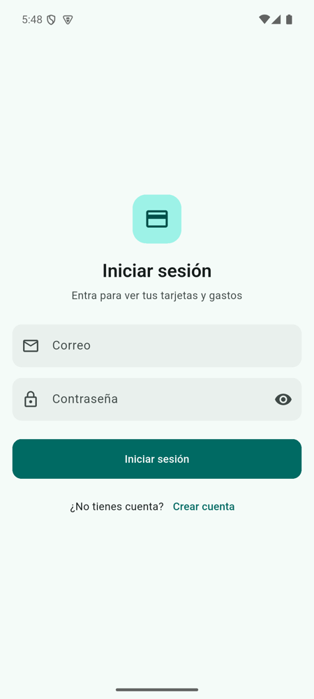
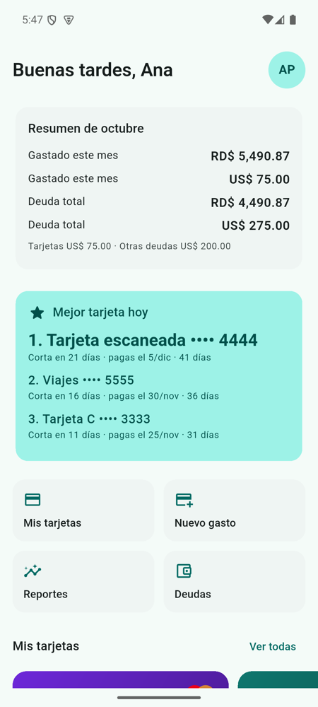
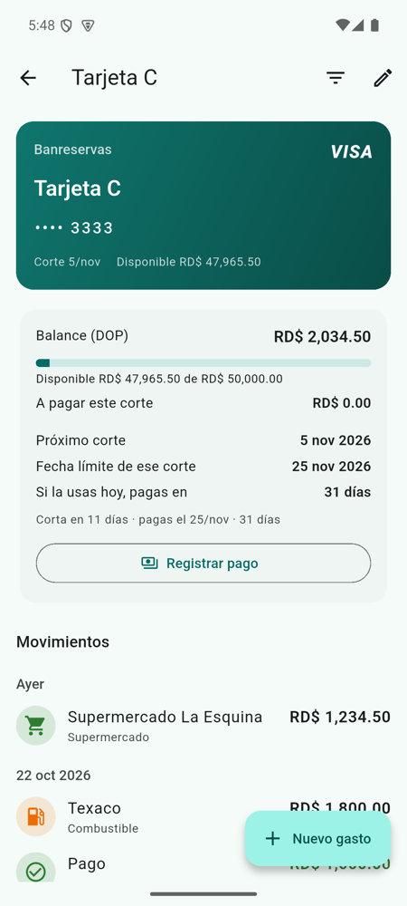
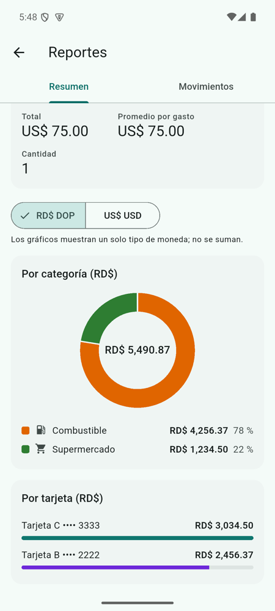
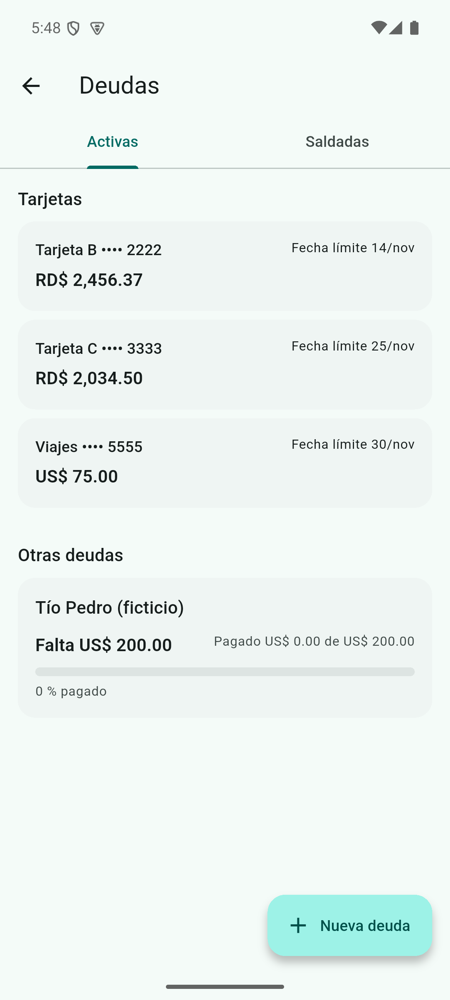
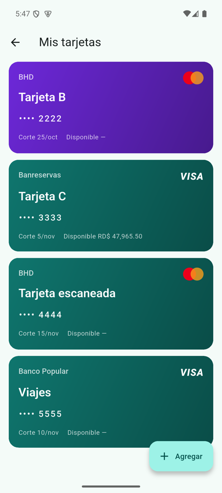
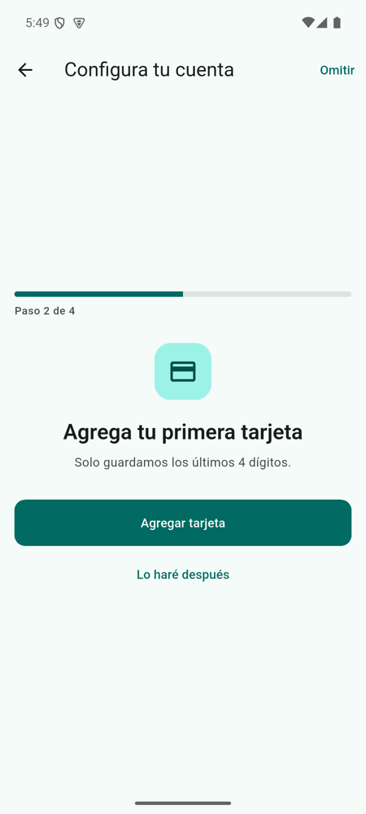
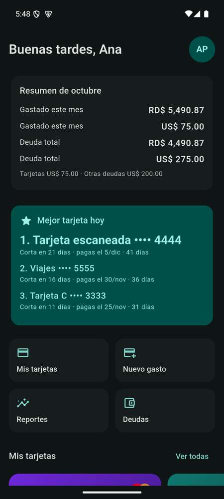

# Tarjetas y Pagos

App Android (Flutter) para llevar tus **tarjetas de crédito, gastos y
deudas** en un solo lugar, saber **qué tarjeta conviene usar hoy** según su
fecha de corte y recibir **recordatorios** antes del corte y del pago. Todo
se guarda en el teléfono (SQLite); la interfaz está en español y maneja
RD$ y US$ por separado.

<p>
  
  
  
  
</p>
<p>
  
  
  
  
</p>

*Capturas con datos ficticios.*

## Funcionalidades

- **Cuenta local:** registro e inicio de sesión con contraseña (PBKDF2),
  sesión recordada, entrada con huella y bloqueo tras intentos fallidos.
- **Bienvenida y asistente:** slides la primera vez y, al registrarse, un
  asistente de 4 pasos (moneda, primera tarjeta, huella, recordatorios).
- **Tarjetas:** alta manual o **escaneando la tarjeta** (OCR en el
  teléfono con ML Kit). Solo se guardan los **últimos 4 dígitos**. Tarjetas
  en RD$, US$ o de doble balance, con límite de crédito.
- **Mejor tarjeta hoy:** ranking por días de financiamiento según el corte
  y los días para pagar, considerando el crédito disponible.
- **Gastos:** por categoría (13 base + personalizadas con ícono y color),
  con conversión US$↔RD$ a la tasa del día y **escaneo de facturas con IA**
  (Claude) opcional.
- **Detalle de tarjeta:** balance, próximo corte, fecha límite, uso del
  límite, movimientos con filtros y registro de pagos.
- **Reportes:** filtros por fechas, tarjetas, categorías, monto y comercio;
  totales, promedio y cantidad por moneda; gráficos por categoría, por mes
  y por tarjeta.
- **Deudas:** lo que deben tus tarjetas y otras deudas con abonos, progreso
  y vencimiento.
- **Perfil:** nombre, correo, contraseña, huella, tema claro/oscuro/sistema,
  moneda predeterminada, días de aviso y categorías.
- **Recordatorios locales** antes del corte, de la fecha límite de pago y
  del vencimiento de deudas.
- **Responsive:** teléfonos pequeños, horizontal, tablet y texto grande.

## Requisitos

- Flutter 3.47 (stable) / Dart 3.13
- JDK 17 y Android SDK con un emulador o un teléfono Android
- Opcional: una clave de la API de Anthropic para el escaneo de facturas

## Cómo correrla

```bash
flutter pub get
flutter test
flutter run
```

La guía completa para desarrolladores (arquitectura, base de datos, lógica
del ciclo de facturación, tests, pruebas E2E con Marionette y flujo de
trabajo) está en **[ONBOARDING.md](ONBOARDING.md)**.

## Tecnología

Flutter · Riverpod · go_router · sqflite · flutter_secure_storage ·
local_auth · google_mlkit_text_recognition · fl_chart ·
flutter_local_notifications · API de Claude (`claude-sonnet-5-5`).

## Estado

El plan está en [`docs/PLAN.md`](docs/PLAN.md) y el avance en el epic
[#12](https://github.com/anicolasp/tarjetas_y_pagos/issues/12). Pendiente:
verificar el escaneo de facturas con la API real (#19).
